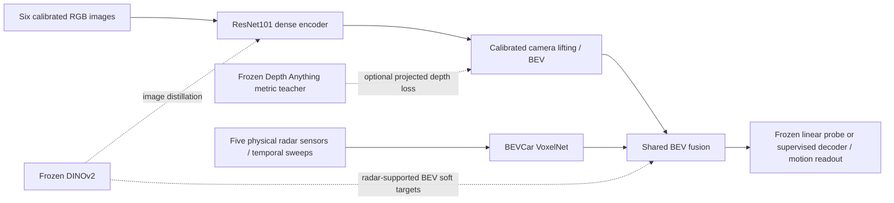

# Architecture and research boundaries

The upstream `nets/segnet.py` and official Simple-BEV training/evaluation path
are preserved. The research package builds opt-in wrappers; it does not replace
the official model, rename state tensors or provide an HTTP inference service.

The two DINO loss terms share a frozen teacher. The image term supervises the
trainable camera encoder; the fused-BEV term uses measured radar anchor support
and existing Gaussian soft regions. Teachers, radar-derived pseudo targets and
supervised nuScenes labels are distinct sources. Low distillation or radar
reconstruction loss is not evidence of independent segmentation generalization.

The official-initialized full-data protocol strictly loads only `encoder.*`
from an official Simple-BEV camera checkpoint and keeps it trainable during
pretraining. The newer random metric-depth protocol explicitly forbids that
initialization. Its two arms both learn 80-bin depth probabilities for lifting;
only one arm adds the frozen metric teacher's projected pseudo-depth CE. Depth
supervision is after calibrated sampling into camera BEV volume, before radar
fusion. No geometry, target width, loss weight or learning budget was changed.

Frozen 1x1 probes before/after fusion test accessibility of vehicle semantics
under a constrained readout. Unfrozen probing and a full supervised decoder
allow adaptation and answer different questions. Object-velocity readouts use
known GT box locations and cannot be presented as detection, NDS or dense
motion accuracy. Official Vehicle IoU remains the primary segmentation metric;
radar intervention loss differences are auxiliary diagnostic evidence.

Module responsibilities and exact I/O live in [interfaces](INTERFACES.md).
Source pinned continuation/strict checkpoints are explained in
[compatibility](integration/COMPATIBILITY.md). Historical experiment changes
must be read in their dated context, not inferred from a filename.
